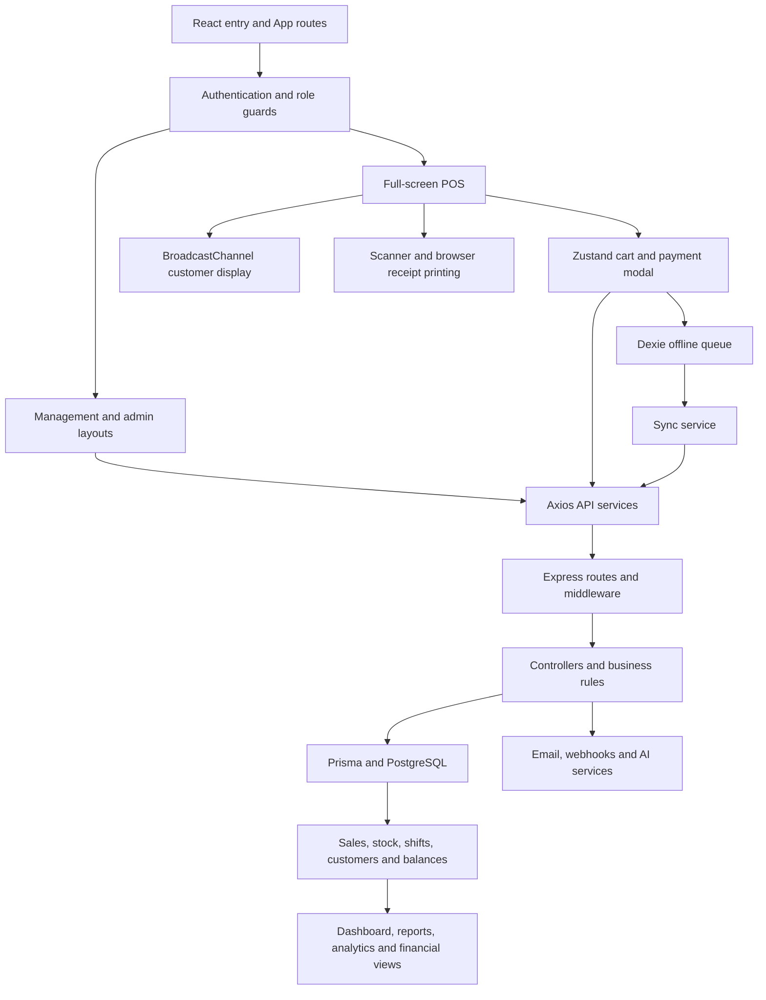

# POS system review

Reviewed October 11, 2026. This is a source-based architecture, workflow, and design review of the current working tree, including its existing uncommitted changes. No application source was changed.

Coverage: mapped all 28 page components, API route groups, shared UI/state layers, and the 47-model Prisma schema; traced core checkout, refunds, permissions, offline replay, and reporting paths in more detail. This is not a claim that every branch has been executed or every defect discovered. Browser tools were unavailable, so visual observations below describe the implementation, not a completed screenshot or usability audit. Database integration tests and physical hardware were not exercised.

## Overall assessment

The project has substantial working structure: a shared visual system, a full register, store management, inventory operations, customer balances, reporting, and integration endpoints. The greatest weaknesses are inconsistencies between alternate paths that should obey the same business rules: registration versus user management, online versus offline checkout, individual versus bulk refunds, and reporting versus financial summaries.

## How the system connects

- `frontend/src/main.tsx` loads Inter, global CSS, and React. `App.tsx` owns routes, authentication initialization, role guards, theme, lazy page loading, and shared settings initialization.
- `components/Layout.tsx` supplies grouped navigation and mobile/collapsed sidebars. POS and customer display bypass that sidebar. `AdminLayout.tsx` is a separate super-admin shell.
- `store/` holds authentication, cart/held sales, favorites, theme, layout, store settings, and admin viewing state. Several stores persist in localStorage.
- `services/api.ts` centralizes Axios requests and token-refresh handling. Pages still own much of their data fetching, loading, filtering, and mutation logic.
- `backend/src/server.ts` installs parsing, CORS, cookies, rate limits, sanitization, uploads, and routes. Route middleware enforces authentication and roles; controllers perform most business logic directly through Prisma.
- Store ownership is primarily expressed through `locationId`. Some entities intentionally allow a null location to represent chain-wide shared records. These semantics differ by entity and should remain explicit.

## Feature map

| Area / pages | Main connection |
|---|---|
| Login, ResetPassword | Auth store → auth API → users, refresh tokens, password recovery and 2FA |
| Dashboard | Report service → sales, refunds, stock and shift aggregates |
| POS | Products/categories + cart + promotions + customer → payment modal → sale transaction |
| CustomerDisplay | Same-origin BroadcastChannel from POS; no server-backed register pairing |
| Inventory | Products, categories, stock logs, CSV import, receipt scanning and barcode labels |
| Suppliers, SuggestedOrders | Supplier/product links → purchase orders → receiving → stock changes |
| InventoryTransfers | Source/destination stores → transfer items → transfer workflow |
| CycleCount | Product snapshot/count entries → stock reconciliation |
| Customers | Customer records → sale history, loyalty, segments and campaign tools |
| Promotions | Promotion records → separate frontend and backend promotion engines |
| GiftCards, StoreCredits, HouseAccounts | Balance accounts and ledgers → checkout tender handling |
| Shifts | Clock-in/out, cash movements, drawer reconciliation and Z reports; checkout requires an open shift |
| Lottery | Ticket types, batches/scanning, daily entries, summaries and day close/reopen |
| Reports | Sales/inventory/employee views, transaction details, bulk actions and exports |
| Financial | Expenses, approval, budgets, recurring expenses, exports and P&L |
| Analytics | Sales/product/customer analyses, forecasts, what-if tools and AI chat |
| AuditLog | ActivityLog queries and filters |
| Settings | User profile/security, shared store/receipt/payment settings and local hardware preferences |
| Team | Store-admin employee management via user API |
| AdminDashboard, StoreManagement, UserManagement, AdminReports | Super-admin store/user administration and cross-store views |
| Developers | API keys and signed webhooks; backend permits SUPER_ADMIN only |
| Exchanges API | Registered backend and frontend service, but no page usage found; separate return path from normal refunds |

The central checkout transaction calculates prices/tax/promotions, creates sale and tender records, changes stock, debits relevant balances, and updates customer and shift totals. Reports then read those records. A bug in checkout or reversal logic can therefore affect inventory, customer balances, employee totals, and financial views together.

## Findings in priority order

### 1. High: alternate registration bypasses user-management restrictions

`backend/src/routes/auth.routes.ts` allows ADMIN and MANAGER to call `/auth/register`. `validators/auth.validator.ts:20` accepts `role: ADMIN` and an arbitrary optional location. `controllers/auth.controller.ts:309` writes those values without checking the caller's allowed role assignments or store.

A manager can create an admin account through this route; omitting the location also creates an unassigned account. The stronger restrictions in `user.controller.ts` do not protect this separate endpoint. Unassigned non-super-admin users are particularly concerning because `utils/locationFilter.util.ts:38` returns an unrestricted filter when no location is present, without requiring SUPER_ADMIN.

Recommended correction: use one account-creation authorization policy and reject missing store assignments for store-bound roles. Make location filters fail closed for non-super-admin users without a store.

### 2. High: receipt numbers collide across stores

`controllers/sale.controller.ts:24` counts sales within a location, but formats the receipt number using only date and count. `prisma/schema.prisma:279` requires the number to be globally unique.

Two stores' first sales on the same day both receive the same number. The retry loop recounts the second store's unchanged sales and can generate the same conflicting number repeatedly. Include a store identifier or use a globally unique sequence; also test concurrent register submissions.

### 3. High: offline fallback can duplicate a committed sale

`frontend/src/pages/POS.tsx:487` generates the online idempotency key. If the response is lost, the fallback calls `createOfflineSale`; `services/syncService.ts:198` generates a different key. Replay uses that new key at line 251.

If the server committed the original sale before connectivity failed, replay can create another sale, deduct stock again, and increment customer/shift totals twice. Preserve one checkout key across original submission, retries, offline storage, and replay.

### 4. High: reversal paths can restore inventory twice

The individual refund path tracks refunded/restocked quantities. Individual void (`sale.controller.ts:1259`) restores every original item when the sale is not fully refunded; it does not subtract quantities already restored by a partial refund. Bulk refund (`:1496`) likewise restores all original quantities. Bulk void (`:1362`) also accepts a fully refunded sale and restores its items again.

Example: sell two units, refund/restock one, then void the sale. The void adds two more instead of the remaining one. Bulk void additionally omits the customer/shift reversals present in individual void. These operations need a shared reversal service and quantity-aware ledger.

### 5. High: exchange endpoint trusts returned product identities and quantities

`controllers/exchange.controller.ts:47` checks ownership of the original sale, then increments each supplied product ID and quantity without validating membership in that sale, remaining returnable quantities, or target-product location. It also does not reconcile through the normal Refund records.

An authorized manager can therefore submit unrelated products, including another store's product ID, or repeat returns. Remove this alternate mutation path or make it use the same validated return workflow as refunds.

### 6. High: financial P&L can subtract a full refund twice

`controllers/financial.controller.ts:591` includes only COMPLETED sales in gross revenue, then subtracts all refunds in the period. A fully refunded sale is already excluded from that gross figure. A single $100 sale fully refunded within the same period can produce $0 gross minus $100 refunds instead of $0 net.

The financial sales export uses a similar pattern. Some report-controller aggregates already use both COMPLETED and REFUNDED sales, so different screens can disagree. Define a shared revenue/refund policy across reports and exports.

P&L also estimates COGS as 60% of net sales (`:626`). The UI does label COGS as estimated; nevertheless, profit/margin figures are not actual inventory-cost accounting. Sales totals include tax, so the revenue presentation also needs a consistent tax-exclusive definition.

### 7. High: offline payload is not equivalent to checkout

`POS.tsx:599` allows offline fallback when CASH is merely the largest tender. A cash/card split can therefore be queued as entirely cash. The queue/replay also drops split references, loyalty redemption, age verification, and price-override metadata.

Consequences include different tender totals, server rejection of age-restricted sales, and different replay pricing. `offlineCreatedAt` is sent by sync but is absent from the sale validator and unused by checkout, so replay does not preserve the original timestamp. Replay also attaches to the currently authenticated user's open shift rather than a stored original cashier/shift.

The cache omits several product flags used by checkout, and POS can replace its product cache with the first 50 unfiltered products. Define precisely which transactions offline mode supports and preserve all required data for them.

### 8. Medium: demotion does not update authorization for existing tokens

`middleware/auth.ts:79` takes role from the JWT, while the database refresh only reads location and active status. `user.controller.ts` invalidates the user cache on updates, but this does not refresh the token's role. A demoted user can retain previous permissions until their access token expires; the configured default lifetime is seven days.

Read current role during authentication or introduce token/session version revocation when permissions change.

### 9. Medium: admin store-view state is not fully connected to POS

`POS.tsx:59` uses only `locationId` from `useEffectiveLocation`, ignoring its `isReadOnly` flag. The product request at `:306` does not pass the selected location, while location tax/settings lookup does use it. Categories/promotions likewise do not receive that viewing location in their POS calls.

This can mix selected-store settings with catalog data scoped by the authenticated account. It also does not implement the README's promised read-only admin POS behavior. Trace one selected store consistently through every request and disable mutations in viewing mode.

### 10. Medium: some hardware/payment capabilities are placeholders

`services/hardware.ts:603` simulates a successful card transaction. The checkout path records CARD tender without an implemented processor authorization workflow. Drawer opening at `:461` logs a command rather than sending a physical pulse, and drawer history returns an empty list. Printer status reflects the enabled setting rather than device connectivity; receipt output uses browser printing.

Recording externally processed card sales may be intentional, but the UI and documentation should distinguish that from integrated card processing. Real terminal, drawer, and printer behavior requires separate verification.

### 11. Medium: cross-origin refresh setup is incomplete

Axios login/logout do not enable credentials, while refresh alone does. The backend issues a `SameSite=strict` refresh cookie (`auth.controller.ts:185`). Local same-origin proxying can hide this mismatch; a frontend and API deployed on different origins/sites need an explicit cookie/CORS design. Runtime deployment behavior was not tested.

### 12. Medium: UI/API permissions disagree on Developers

`App.tsx` and `Layout.tsx` expose Developers to ADMIN, but `routes/developer.routes.ts` permits only SUPER_ADMIN because integration data is chain-wide. Store admins can navigate into a page whose requests are denied. Align page guards and navigation with the backend policy.

Additional follow-up risks: refund eligibility is read before its transaction, so simultaneous refunds need concurrency tests; gift-card/store-credit balance checks also need concurrent-debit tests. These are source-based race concerns, not reproduced failures in this review.

## Fonts, styling, and interaction design

| Element | Current implementation |
|---|---|
| Main font | Locally bundled Inter Variable, imported in `main.tsx`; Tailwind sans stack falls back to Inter/system sans |
| Printed receipts | Monospace/Courier-style typography; white receipt paper preview is intentional even in dark mode |
| Page titles | Shared PageHeader uses 30px bold (`text-3xl`) |
| Dialog titles | 20px, increasing to 24px at the small breakpoint |
| Common text | Predominantly 14–16px; badges and register helper labels go down to 9–11px |
| Colors | HSL CSS variables; blue primary, neutral surfaces, green success, amber warning, red destructive |
| Light/dark mode | White/slate light palette; near-black neutral dark palette; class-based theme |
| Shape | 8px base radius, smaller derived control radii, rounded cards and restrained borders |
| Icons | Lucide icons across navigation, actions and statuses |
| Buttons | Shared variants; 36px, 40px and 48px heights |
| Inputs | Shared 40px height, border/ring styling and inline error text |
| Management layout | 256px expanded / 64px collapsed sidebar with grouped sections and mobile menu |
| Register layout | Product grid grows from 2 to 6 columns; cart is full width on small screens, 320px/384px at larger breakpoints |
| Feedback | Toasts, loading placeholders, empty states, confirmation dialogs and offline indicator |
| Motion | Fade/scale/slide/shimmer/cart animations, mostly 0.2–0.3 seconds |

Strengths: the visual language is already shared across most pages; the register has keyboard shortcuts and a task-focused layout; modals have a focus trap, Escape dismissal, and dialog semantics; the grid has meaningful loading/empty states.

Design/accessibility improvements supported by code:

1. Shared `Input.tsx:14` renders a label without `htmlFor` or an automatically associated ID. Error text is not linked through `aria-describedby`, and invalid status is not set automatically. Fixing the primitive improves every consumer.
2. Register helper labels at 9–11px and several 36px icon controls deserve real touch-screen testing. Keep essential checkout information larger and give frequent actions more forgiving hit areas.
3. There is no reduced-motion override in the global stylesheet. Add one for decorative animations.
4. PageHeader title truncation and nonwrapping action groups need narrow-screen checks with long store names and multiple actions.
5. Use tabular numerals consistently for money, quantities and changing totals. Inter can remain the single primary font.
6. Verify dark-mode chart labels, hard-coded semantic shades, modal stacking, long tables, zoom, keyboard navigation, and empty/error states in a live browser before declaring visual consistency complete.

The main design need is consistent behavior and readability. A wholesale font or color replacement is not justified by this source review.

## Maintainability and validation

Large page/controller files concentrate many responsibilities: Analytics is 1,886 lines, Reports 1,743, Suppliers 1,166, and Financial 1,010. Extract business operations and data hooks incrementally, starting with checkout/reversal/reporting rules. Shared frontend/backend promotion logic should have parity tests to prevent drift. Monetary database fields use Float; consider an explicit integer-cents or decimal strategy with consistent rounding boundaries.

Validation performed:

- Frontend production build: passed (`npm run build --workspace=frontend`).
- Backend TypeScript check: passed (`tsc -p backend/tsconfig.json --noEmit`).
- Backend unit tests: passed, 6 suites / 91 tests.
- Frontend lint: failed, 20 errors. See `review-lint.log`; missing `react-hooks/exhaustive-deps` rule configuration is among the causes.
- Build warnings: stale browser metadata and a module that is imported both statically and dynamically. These did not prevent the build.
- Database integration suites were not run: they truncate tables and require an isolated test database. No database was seeded or migrated.
- No browser screenshots, processor transactions, physical scanner/printer/drawer tests, or live third-party requests were performed.

Recommended order: close authorization gaps; correct cross-store receipt numbers and checkout identity; unify refunds/voids/exchanges; reconcile financial calculations; specify offline guarantees; then finish UI permission/accessibility consistency and live visual verification.
